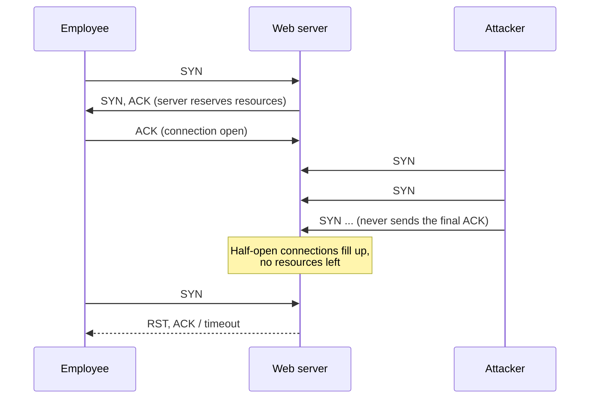

# SYN Flood Attack Analysis

## Summary
A company website suddenly stopped loading and users got a **connection timeout** error. I analysed the packet capture of the web server traffic and found that one IP address was flooding the server with TCP SYN requests. The server ran out of resources and stopped responding to real users. This was a **direct DoS SYN flood attack**.

## Scenario
- **Company:** A travel agency that shows sales and holiday packages on its website. Employees use the sales page every day.
- **Alert:** The monitoring system raised an alert about the web server.
- **Symptom:** When I opened the website, I got a connection timeout error.
- **Investigation:** I used a packet sniffer to capture traffic going to and from the web server.

## Tools and skills
| Area | Used for |
|---|---|
| Packet capture (Wireshark-style log) | Reading TCP and HTTP traffic |
| TCP three-way handshake | Separating normal connections from attack traffic |
| DoS / SYN flood detection | Finding the attacker and the impact |
| Incident reporting | Explaining the issue clearly |

## Key systems
| Item | Value |
|---|---|
| Web server | `192.0.2.1` (port `443`, HTTPS) |
| Employee computers | `198.51.100.0/24` |
| Attacker | `203.0.113.0` (source port `54770`) |

## Log evidence
**Normal traffic (handshake + page load):**
```
47  3.144521  198.51.100.23 -> 192.0.2.1      TCP   42584->443 [SYN]
48  3.195755  192.0.2.1     -> 198.51.100.23  TCP   443->42584 [SYN, ACK]
49  3.246989  198.51.100.23 -> 192.0.2.1      TCP   42584->443 [ACK]
50  3.298223  198.51.100.23 -> 192.0.2.1      HTTP  GET /sales.html HTTP/1.1
51  3.349457  192.0.2.1     -> 198.51.100.23  HTTP  HTTP/1.1 200 OK (text/html)
```

**Attack traffic and errors for real users:**
```
52  3.390692  203.0.113.0   -> 192.0.2.1      TCP   54770->443 [SYN]
73  6.230548  192.0.2.1     -> 198.51.100.16  TCP   443->32641 [RST, ACK]
77  7.330577  192.0.2.1     -> 198.51.100.5   HTTP  HTTP/1.1 504 Gateway Time-out
125 21.136783 203.0.113.0   -> 192.0.2.1      TCP   54770->443 [SYN]
```

### How to read one log line
| Field | Example | Meaning |
|---|---|---|
| No. | `47` | Packet number in the capture |
| Time | `3.144521` | Seconds since the capture started |
| Source → Destination | `198.51.100.23 -> 192.0.2.1` | Who sent the packet → who received it |
| Protocol | `TCP` / `HTTP` | TCP = connection setup, HTTP = web request |
| Ports | `42584->443` | Client's random port → server's HTTPS port |
| Flags | `[SYN]`, `[SYN, ACK]`, `[ACK]`, `[RST, ACK]` | Step of the handshake, or a reset (connection refused) |

## Timeline
| Log entries | What happened | Server status |
|---|---|---|
| 47–51 | Employee completes handshake and loads `sales.html` (`200 OK`) | Normal |
| 52–62 | Attacker starts sending SYN packets; another employee still loads the page | Under load, still working |
| 63–88 | Employees get `504 Gateway Time-out` and `[RST, ACK]` | Real users start failing |
| 89–124 | Almost every employee request is reset | Nearly down |
| 125 onward | Only the attacker's SYN packets appear; the server sends no replies | Down |

## How the attack works


## Incident report

### Section 1: Type of attack
**Possible explanation for the timeout error:**
The website's connection timeout is most likely caused by a DoS attack. At first the logs show normal traffic: the employee `198.51.100.23` completes the TCP three-way handshake with the web server `192.0.2.1` on port 443 and loads `sales.html`. Then the IP `203.0.113.0` starts sending a very large number of SYN packets to the server. The server cannot handle so many requests and stops responding.

**What the logs show:**
The IP `203.0.113.0` keeps sending SYN requests to the web server, several every second, all from the same source port `54770`. In the beginning the server still answers real users (`198.51.100.14` opens a connection and loads `sales.html`). After that, real users start getting two types of errors:
- **HTTP/1.1 504 Gateway Time-out:** a gateway in front of the web server waited for the server, got no reply in time, and sent a timeout error to the user's browser.
- **[RST, ACK]:** the server resets the connection request instead of completing it. The user sees a timeout error and has to try again.

**This event could be:**
A direct DoS SYN flood attack, because all the attack traffic comes from only one IP address.

### Section 2: How the attack breaks the website
**TCP three-way handshake:**
1. **[SYN]** – The client sends a SYN packet to the server to ask for a connection (SYN = synchronize).
2. **[SYN, ACK]** – The server replies and agrees to connect. It reserves some resources and waits for the last step.
3. **[ACK]** – The client confirms. The connection is now open and the browser can send the HTTP request.

**What happens when an attacker sends many SYN packets at once:**
For every SYN, the server reserves resources and waits for a final ACK. The attacker sends SYN packets but never finishes the handshake, so these half-open connections pile up. When the server runs out of resources, nothing is left for real users and their connection requests fail. This is a SYN flood, a type of DoS attack.

**What the logs indicate and how this affects the server:**
The server slowly loses its ability to serve real users. First it still responds, then employees get `504` and `[RST, ACK]` errors, and from log entry 125 onward the server stops responding completely. The only packets in the log after that point come from the attacker.

## Response and next steps
| Done | Next |
|---|---|
| Took the web server offline so it could recover | Turn on SYN cookies on the server |
| Blocked `203.0.113.0` on the firewall | Add rate limiting for new connections per IP |
| Reported the issue to the manager | Use an IPS / firewall rule to detect SYN floods, since the attacker can spoof a new IP and get around a single-IP block |
| | Set up alerts for sudden spikes in SYN traffic |
