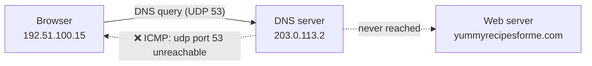

# 03 — Network Structure and Security Analysis

## Incident report: Network traffic analysis

A website stopped loading for users. I captured the network traffic with `tcpdump`, read the DNS and ICMP packets, and wrote an incident report on what went wrong.

## Scenario

Customers of a client company said they could not open the company's website. After waiting, their browser showed a "destination port unreachable" error. I tried to load the site myself, captured the traffic while it failed, and checked the log to find where the request was stopping.

## Skills used

- Packet capture with `tcpdump`
- Reading DNS and ICMP traffic
- Finding the root cause of a network problem
- Writing an incident report

## How the request failed



The browser must first ask the DNS server for the website's IP address. The DNS server did not answer, so the browser never got the IP and the request never reached the web server.

## Log sample

A shortened example of what the capture showed:

```
13:24:32.192571 IP 192.51.100.15.52444 > 203.0.113.2.domain: 35084+ A? yummyrecipesforme.com. (24)
13:24:32.192571 IP 203.0.113.2 > 192.51.100.15: ICMP 203.0.113.2 udp port 53 unreachable length 254
```

### How to read the DNS query line

| Part | Value | Meaning |
|---|---|---|
| Timestamp | `13:24:32.192571` | When the packet was sent (hours:minutes:seconds) |
| Source IP.port | `192.51.100.15.52444` | My computer, sending from port 52444 |
| Destination IP.domain | `203.0.113.2.domain` | The DNS server. `.domain` means port 53, the DNS port |
| Query ID | `35084+` | ID number of this DNS query. `+` is a flag: it asks the DNS server to find the full answer |
| `A?` | `A? yummyrecipesforme.com.` | Asks for the A record, which is the IP address of the website |
| Size | `(24)` | Size of the query in bytes |

### How to read the ICMP reply line

| Part | Value | Meaning |
|---|---|---|
| From → to | `203.0.113.2 > 192.51.100.15` | Reply came back from the DNS server to my computer |
| Protocol | `ICMP` | Used to send error messages |
| Error | `udp port 53 unreachable` | Nothing on the DNS server answered on port 53 |
| Size | `length 254` | Size of the ICMP packet |

The same query and error repeated three times in the capture.

## Incident report

### Part 1: Summary of the problem

- **The UDP protocol reveals that:** We're unable to reach the DNS because no service was listening on the receiving DNS port.
- **This is based on:** The network analysis shows that the ICMP reply returned the error message `udp port 53 unreachable`.
- **The port in the error message is used for:** The DNS service.
- **Flags in the log:** The `+` after query ID 35084 and the `A?` show that my computer sent a normal DNS request asking for the website's IP address. So the request was fine; the DNS server did not answer it.
- **The most likely issue is:** DNS server 203.0.113.2 was not responding on port 53. Either the DNS service is down or the firewall is blocking UDP port 53.

### Part 2: Analysis and cause

- **Time incident occurred:** 13:24:32
- **How the IT team became aware:** Several customers of the client reported that they were not able to access the client company website www.yummyrecipesforme.com, and saw the error "destination port unreachable" after waiting for the page to load.
- **Actions taken to investigate:** Tried to reproduce the issue, ran `tcpdump` and loaded the website again. Captured the DNS query and ICMP replies for further analysis.
- **Key findings:** DNS server 203.0.113.2. Source 192.51.100.15 sent a DNS query for the A record and received ICMP "udp port 53 unreachable" thrice.
- **Likely cause:** DNS server down/misconfigured, a possible DoS attack, or the firewall is blocking UDP port 53.

## What I learned

- If DNS fails, the website fails, even when the web server itself is fine.
- In `tcpdump`, `.domain` after an IP is not part of the address. It is the port name for 53.
- ICMP carries error messages, so it shows where a request stopped.
