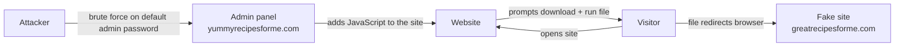

# Incident Report: Brute Force Attack and Malicious Redirect

## Summary
A former employee guessed the default admin password of a recipe website with a brute force attack. They added JavaScript to the site that made visitors download a malicious file. The file sent visitors to a fake copy of the website. I reproduced the attack in a sandbox, captured the traffic with `tcpdump`, and documented the incident. The main protocol involved was **HTTP**.

## Scenario
- **Website:** `yummyrecipesforme.com`, which sells recipes and cookbooks.
- **What users saw:** The site asked them to download a file for free recipes. After running it, the website address changed and their computers became slow.
- **What the owner saw:** They could not log in to the admin panel anymore.
- **My task:** Find out what happened, identify the network protocols, and recommend a fix for brute force attacks.

## Skills used
| Area | Used for |
|---|---|
| `tcpdump` | Capturing DNS and HTTP traffic in a sandbox |
| TCP/IP model | Identifying protocols at each layer (DNS, TCP, HTTP) |
| Log analysis | Spotting the sudden switch to a new website |
| Incident reporting | Documenting what happened, how, and how it was found |
| Hardening | Recommending controls against brute force |

## How the attack worked


## Log evidence
```
14:18:32.192571 IP your.machine.52444 > dns.google.domain: 35084+ A? yummyrecipesforme.com. (24)
14:18:32.204388 IP dns.google.domain > your.machine.52444: 35084 1/0/0 A 203.0.113.22 (40)
14:18:36.786501 IP your.machine.36086 > yummyrecipesforme.com.http: Flags [S] ...
14:18:36.786589 IP your.machine.36086 > yummyrecipesforme.com.http: Flags [P.] ... HTTP: GET / HTTP/1.1
...<a lot of traffic on port 80>...
14:20:32.192571 IP your.machine.52444 > dns.google.domain: 21899+ A? greatrecipesforme.com. (24)
14:20:32.204388 IP dns.google.domain > your.machine.52444: 21899 1/0/0 A 192.0.2.17 (40)
14:25:29.576493 IP your.machine.56378 > greatrecipesforme.com.http: Flags [S] ...
14:25:29.576590 IP your.machine.56378 > greatrecipesforme.com.http: Flags [P.] ... HTTP: GET / HTTP/1.1
```

### How to read the log
| Part | Example | Meaning |
|---|---|---|
| Time | `14:18:32.192571` | When the packet was sent |
| Source IP.port | `your.machine.52444` | My computer, using a temporary port |
| `.domain` | `dns.google.domain` | Port 53 (DNS) |
| `.http` | `yummyrecipesforme.com.http` | Port 80 (HTTP) |
| `A?` / `A 203.0.113.22` | DNS question / DNS answer | "What is the IP?" / "Here is the IP" |
| `Flags [S]` | Connection start | First step of the TCP handshake |
| `Flags [S.]` | Start + acknowledge | Server agrees to connect |
| `Flags [.]` | Acknowledge | Confirms data or the handshake |
| `Flags [P.]` | Push + acknowledge | Data is being sent (here, the HTTP request) |

### Why the client port changes
Each new connection gets a new temporary port from my computer: `52444` for DNS, `36086` for the real site, `56378` for the fake site. A new port means a new, separate connection. The port change itself is normal. The warning sign is that the browser connected to a site the user never typed.

## Timeline
| Time | Event |
|---|---|
| 14:18:32 | Browser asks DNS for the IP of `yummyrecipesforme.com` and gets `203.0.113.22` |
| 14:18:36 | TCP connection to the real site, then `GET /` over HTTP |
| 14:18 – 14:20 | About 2 minutes of HTTP traffic on port 80; the malicious file is downloaded and run |
| 14:20:32 | Browser suddenly asks DNS for `greatrecipesforme.com` and gets `192.0.2.17` |
| 14:25:29 | New TCP connection and HTTP request to the fake site |

## Incident report

### Section 1: Network protocol involved
The network protocols involved in this incident are **DNS (port 53)** and **HTTP (port 80)**. HTTP is the main one, because the malicious file was downloaded and the browser was sent to the fake site over HTTP, at the application layer.

### Section 2: Document the incident
Our helpdesk team received several emails from customers. When they visited `yummyrecipesforme.com`, they were prompted to download and run a file. After running it, they were redirected to a different website and their computers became slow. The website owner also could not log in to the admin panel.

As the cybersecurity analyst, I opened the website in a sandbox so that the company network stays safe. I ran `tcpdump` to capture the traffic while I used the site. The website asked me to download a file to update my browser. I downloaded it and ran it. The browser then redirected me to a fake website (`greatrecipesforme.com`).

In the log, my computer first sends a DNS request from port 52444 to the DNS server for `yummyrecipesforme.com`. Then it opens a TCP connection from port 36086 to the website on port 80 (`.http`). The entry `HTTP: GET / HTTP/1.1` shows the browser asking the website for its page; this is likely when the malicious file was downloaded. After about 2 minutes, my computer sends a new DNS request for `greatrecipesforme.com`, and the DNS server replies with the IP `192.0.2.17`. From then on, the traffic goes between my computer (now using port 56378) and the fake website.

The senior analyst checked the website's source code and found JavaScript that prompted visitors to download the malicious file. The file contained a script that sent the browser from `yummyrecipesforme.com` to `greatrecipesforme.com`. The attacker used a brute force attack on the admin account. The admin panel still had a default password, and there were no controls to stop repeated login attempts, so the attacker was able to take control. The attacker then changed the admin password, which is why the owner could not log in.

### Section 3: Remediation for brute force attacks
| Measure | Why it works |
|---|---|
| **Strong password policy** – at least one capital letter, numbers and special characters, and no default passwords | The attacker only got in because the default password was easy to guess. A long, unique password makes guessing take far too long. |
| **Multi-factor authentication (MFA / 2FA)** | Even if the attacker guesses the password, they still need a second code (for example, an OTP on the owner's phone), so the login fails. |

## What I learned
- `.domain` and `.http` in `tcpdump` are port names (53 and 80), not part of the address.
- A sudden DNS request for a domain the user never typed is a strong sign of a redirect.
- Default passwords plus no login limits make brute force attacks easy.
