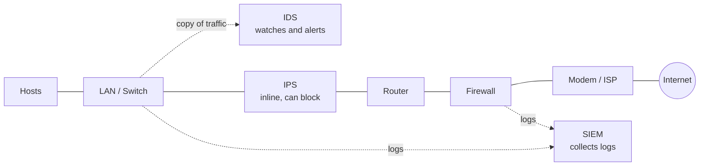

# Security Risk Assessment: Network Hardening

## Summary
A social media company had a data breach that exposed customer names and addresses. I checked the network, found four weak points, and recommended three hardening methods to stop the same thing from happening again: **multi-factor authentication (MFA)**, **a strong password policy**, and **regular firewall maintenance**.

## Scenario
- **Company:** A social media organization.
- **Incident:** A major data breach exposed customers' personal information.
- **Goal:** Put hardening practices in place that the team can repeat consistently.

## Vulnerabilities found
| # | Vulnerability | Risk | Fix |
|---|---|---|---|
| 1 | Employees share passwords | One leaked password opens many accounts, and no one knows who did what | Password policy + MFA |
| 2 | Database admin password is still the default | Default passwords are public and easy to guess | Password policy (change it now) + MFA |
| 3 | Firewall has no rules for incoming and outgoing traffic | Any traffic can get in or out, including attacks and stolen data | Firewall maintenance |
| 4 | MFA is not used | A guessed or stolen password is enough to log in | MFA |

## Skills used
| Area | Used for |
|---|---|
| Risk assessment | Matching each vulnerability to its risk |
| Network hardening | Choosing the right controls |
| Access control | Password policy and MFA design |
| Firewall management | Filtering traffic in and out of the network |

## Security risk assessment report

### Part 1: Hardening tools and methods
**1. Password policies**
Set rules for stronger passwords based on NIST password guidelines. Passwords should be stored with hashing and salting, so that stored passwords stay safe even if the database leaks. The policy stops attackers from guessing user passwords, by hand or with a script.

**2. Multi-factor authentication (MFA)**
MFA is an extra layer of security: a person needs two or more methods to prove who they are. These come from something you know (password, PIN), something you have (phone, badge, one-time code) and something you are (fingerprint, face). It protects against brute force attacks. MFA can be set up at any time; it is mostly set up once and then maintained.

**3. Firewall maintenance**
The firewall controls the flow of incoming and outgoing traffic and keeps unwanted traffic out of the network. Its rules need to be checked and updated regularly to protect the private network from attacks such as DDoS.

### Part 2: Recommendations
Based on the four vulnerabilities, I recommend **strong password policies and MFA** first, because employees share passwords and the admin password is still the default. With a strong password policy and MFA in place, it will be hard for an attacker to break into the system, and the system will be protected from brute force attacks. The policy should make the team:
- change the default admin password right away,
- give every employee their own account (no sharing),
- lock an account after 5 failed logins.

The policy should always be enforced and reviewed regularly. MFA is set up once and then maintained.

**Firewall maintenance** is also a priority. No firewall rules have been set to filter traffic coming in and out of the network, so the attack surface is large and any unwanted traffic can get in, which can result in a DoS or DDoS attack. Firewall rules should be checked regularly and updated after every security event.

| Method | Fixes | How often |
|---|---|---|
| Password policy | #1, #2 | Always enforced; default password changed now; reviewed regularly |
| MFA | #1, #2, #4 | Set up once, then maintained |
| Firewall maintenance | #3 | Regularly, and after every security event |

## Network security tools: where they sit and what they do
A hardened network uses more than one tool, each in a different place.

| Tool | Strength | Limit |
|---|---|---|
| **Firewall** | Allows or blocks traffic based on rules | A basic firewall only checks packet headers. A next-generation firewall (NGFW) can also look inside the packet |
| **IDS** (Intrusion Detection System) | Watches traffic and alerts the team about possible attacks | Does not stop the traffic. A signature-based IDS only catches known attacks; an anomaly-based IDS can also catch unusual behaviour |
| **IPS** (Intrusion Prevention System) | Watches traffic and blocks attacks on the spot | Sits inline, so if it fails the connection can break (unless it is set to fail open). Can block real traffic by mistake (false positives) |
| **SIEM** (Security Information and Event Management) | Collects logs from many devices into one dashboard | Only reports. To act automatically, it needs to work with a SOAR tool |

## What I learned
- Each vulnerability should map to a clear fix, so nothing is left open.
- Hashing protects stored passwords; lockouts and MFA stop password guessing.
- Hardening is not one-time work: some controls are set once, others (like firewall rules) need regular updates.
- Security tools work best together: the firewall filters, IDS/IPS watch, and SIEM brings it all into one view.
